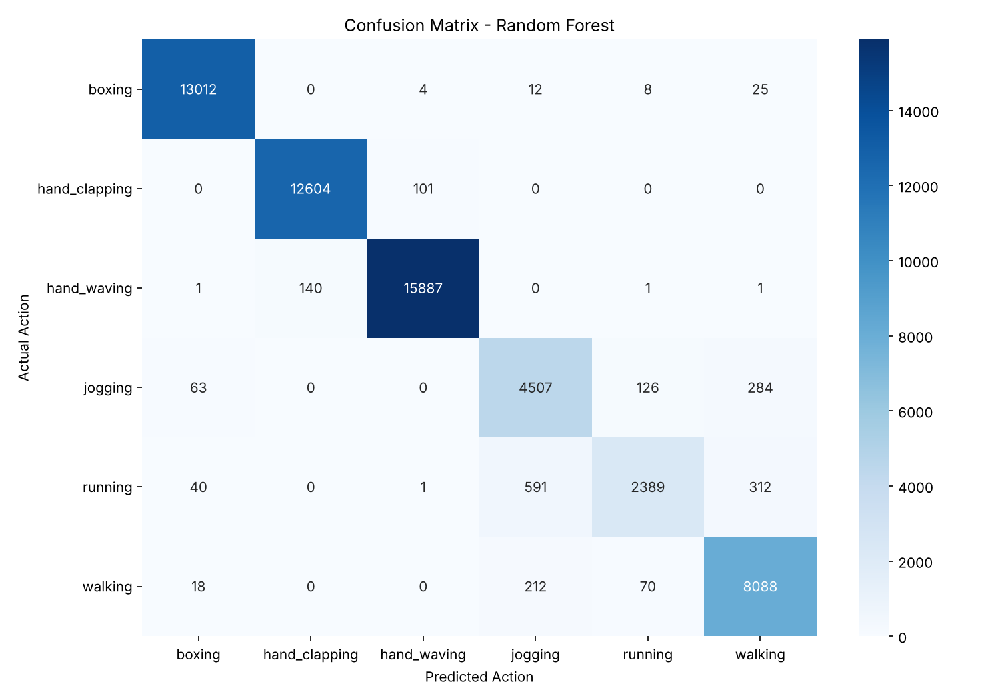
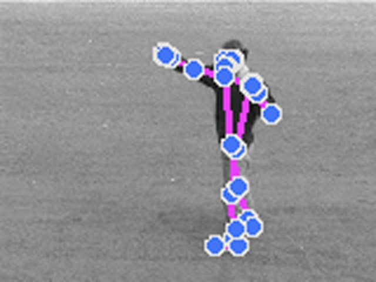

# Human Action Recognition

A machine learning application that classifies human actions from video using **MediaPipe Pose** for skeleton extraction and **Scikit-Learn** for classification. It is trained on the **KTH dataset** and includes a **real-time webcam demo**. The best model, a Random Forest, reaches **96.56% accuracy** on the held-out test set.

Built for **CSE381 – Introduction to Machine Learning**, Faculty of Engineering, Ain Shams University (ICHEP – CESS program).

## Recognized Actions

| | | |
|---|---|---|
| Boxing | Hand clapping | Hand waving |
| Jogging | Running | Walking |

## How It Works

```
KTH videos ──► MediaPipe Pose ──► 33 landmarks × (x, y, z, visibility) = 132 features ──► CSV
                                                                                          │
                                         Random Forest feature selection (132 → 35 features)
                                                                                          │
                                              Train & compare 6 classifiers ──► best model saved

Webcam frame ──► MediaPipe Pose ──► saved selector ──► saved model ──► action + confidence
```

1. **Feature extraction (`make_data.py`)**: each frame of every video goes through MediaPipe Pose. Each of the 33 landmarks gives `x`, `y`, `z` and `visibility`, so one frame becomes a row of 132 features plus the action label. All rows are saved to `action_dataset.csv`.
2. **Training (`train_model.py`)**:
   - Splits the data 70% train / 30% test (`random_state=42`).
   - Selects features with `SelectFromModel` on a Random Forest, reducing **132 features to 35**.
   - Trains six classifiers on the same selected features and keeps the one with the highest test accuracy.
   - Saves the best model to `action_model.pkl` and the selector to `selector.pkl`.
3. **Real-time inference (`test_realtime.py`)**: reads webcam frames, extracts the pose, applies the saved selector and model, and overlays the predicted action with its confidence. Predictions below **70% confidence** are shown as "Unsure...".

## Results

| Model | Test Accuracy |
|---|---|
| **Random Forest** | **96.56%** |
| XGBoost | 96.34% |
| KNN (k=5) | 94.09% |
| ANN (MLP, 64-32) | 92.88% |
| Decision Tree | 91.67% |
| SVM | 88.59% |

Random Forest and XGBoost clearly lead, likely because tree ensembles handle this kind of pose data well.

The confusion matrix of the best model shows that most errors are **running being predicted as jogging** (and the reverse). These two actions differ mainly in speed rather than in the pose seen in a single frame, which a frame-by-frame classifier cannot capture.



For the full methodology and analysis, see [`Machine Learning Report.pdf`](Machine%20Learning%20Report.pdf).


*MediaPipe pose landmarks detected on a frame from the KTH dataset.*

## Repository Structure

```
human-action-recognition/
├── make_data.py                  # Extract pose landmarks from KTH videos into a CSV
├── train_model.py                # Select features, compare 6 classifiers, save the best
├── test_realtime.py              # Live webcam demo
├── get_report_screenshot.py      # Helper script that generates the report screenshot
├── Machine Learning Report.pdf   # Full project report
├── clean_report_screenshot.jpg   # Example of MediaPipe landmarks on a KTH frame
├── confusion_matrix.png          # Confusion matrix of the best model (Random Forest)
├── dataset link.docx             # Link to the dataset
├── LICENSE
└── .gitignore
```

## Requirements

- Python 3.8+
- A webcam (for the real-time demo)

Python packages:

```
opencv-python
mediapipe
numpy
pandas
scikit-learn
xgboost
seaborn
matplotlib
```

## Installation

```bash
git clone https://github.com/mykhallaf/human-action-recognition.git
cd human-action-recognition

# (optional) create a virtual environment
python -m venv venv
source venv/bin/activate        # On Windows: venv\Scripts\activate

pip install opencv-python mediapipe numpy pandas scikit-learn xgboost seaborn matplotlib
```

> **Note:** `make_data.py` and `test_realtime.py` use the `mp.solutions.pose` API, which is available in the classic MediaPipe Python package. If you hit an `AttributeError` on `mp.solutions`, install a version that still ships it (e.g. `pip install mediapipe==0.10.14`).

## Usage

### 1. Get the dataset

Download the KTH dataset (the link is in `dataset link.docx`) and place the videos in a `dataset/` folder with one subfolder per action:

```
dataset/
├── boxing/
├── hand_clapping/
├── hand_waving/
├── jogging/
├── running/
└── walking/
```

### 2. Extract features

```bash
python make_data.py
```

This processes every video and writes `action_dataset.csv` (one row per frame). It can take a while.

### 3. Train the models

```bash
python train_model.py
```

This prints each model's accuracy and shows the confusion matrix of the best one. **Close the plot window** to let the script continue, after which it saves `action_model.pkl` and `selector.pkl`.

### 4. Run the real-time demo

```bash
python test_realtime.py
```

- The webcam feed opens full screen with your pose skeleton drawn on top.
- The predicted action and confidence appear in the top-left corner.
- Press **`q`** to quit.

## Limitations

- **Single-frame classification:** the model sees one frame at a time and has no sense of motion over time, so similar actions (jogging vs. running) are the most commonly confused.
- **Frame-level split:** the train/test split is done on individual frames, so frames from the same video can appear in both sets. This can make the reported accuracy higher than what you would see on completely unseen videos or people.
- **Dataset conditions:** KTH has simple backgrounds and a small set of actions, so webcam performance may differ from the test results.
- Only one person is tracked at a time.

## Future Work

- Use temporal models (LSTM or GRU) to capture motion across frames
- Combine CNN features with pose information
- Expand the dataset with more action classes and more varied examples
- Deploy on mobile or embedded devices

## Acknowledgements

- [KTH Action Dataset](https://www.csc.kth.se/cvap/actions/)
- [MediaPipe Pose](https://developers.google.com/mediapipe/solutions/vision/pose_landmarker)
- [Scikit-Learn](https://scikit-learn.org/), [XGBoost](https://xgboost.readthedocs.io/), [OpenCV](https://opencv.org/)

## Authors

- **Mohamed Khallaf** – [@mykhallaf](https://github.com/mykhallaf)
- **Abdallah Bahaa**

Supervised by Dr. Alaa Mahmoud Hamdy, Eng. George Welson, and Eng. Engy Ahmed.

## License

This project is licensed under the [MIT License](LICENSE).
